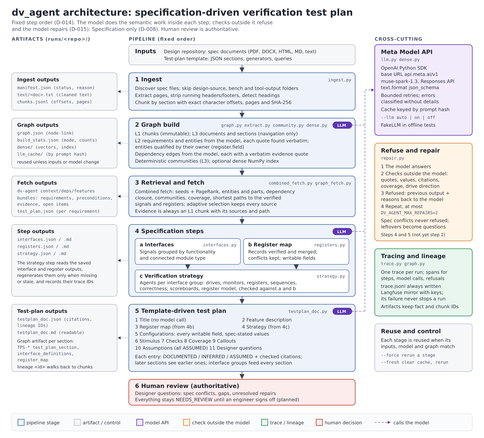

# dv_agent architecture

dv_agent turns a design repository's specification documents into a reviewed, traceable verification
test plan, using Meta's Muse Spark model for the semantic work and deterministic checks to keep it honest.



Editable source: [`architecture.svg`](architecture.svg) (regenerate the PNG from it after edits).

## Principles

| Principle | Where it is enforced |
|---|---|
| Specification only: no design source is read or mentioned (D-008) | `ingest.discover` skips design-source, bench and tool-output folders; prompts and templates name only the specification |
| Fixed step order chosen by the user; the model never picks the next step (D-014) | `pipeline.py`, `testplan_doc.build_testplan_doc` |
| The model does the semantic work; code verifies it | Every model call goes through a schema and a check (below) |
| Checks outside the model refuse its output and the model repairs it (D-015) | `repair.structured_with_repair` |
| Specification conflicts are reported, never resolved silently | `registers._merge`, designer questions |
| Every statement traces to an exact specification location | Chunk offsets, verbatim quotes, citation filters, graph lineage |
| Human review is authoritative | Everything is `NEEDS_REVIEW`; designer questions; sign-off command planned |

## Pipeline

| # | Stage | Modules | Model calls | Checks | Outputs |
|---|---|---|---|---|---|
| 1 | Ingest | `ingest.py` | none | discovery rules (format preference, skipped folders, changelogs); every skip has a reason | `manifest.json`, `text/`, `chunks.jsonl` |
| 2 | Graph build | `graph.py`, `extract.py`, `community.py`, `dense.py` | `spec_requirements` per chunk; `requirement_dependencies` per entity group; optional embeddings | quotes located verbatim (whitespace and typography tolerant); dependency evidence quote must be in an endpoint's quote; entity references resolved by owner | `graph.json`, `build_stats.json`, `dense/` |
| 3 | Retrieval and fetch | `retrieval.py`, `graph_fetch.py`, `combined_fetch.py`, `testplan_context.py`, `planning.py` | `rerank_chunks`, `test_plan_items` (per-requirement `plan` command) | evidence is always an L1 chunk; every item records its sources and path; citations limited to retrieved IDs | `query`, `context`, `deps`, `features` output; `test_plan.json` |
| 4a | Interfaces | `interfaces.py` | `testplan_interfaces` | names and defining quotes in the cited chunk; direction, width and active level marked when not stated; one group per signal; groups sharing functionality and module type flagged | `interfaces.json/.md` |
| 4b | Register map | `registers.py` | `testplan_registers` per batch of chunks | names, quotes, addresses, widths, access, reset values and encodings must be written in the chunk; records merged across chunks; conflicts and overlaps reported; writable fields from access codes | `registers.json/.md` |
| 4c | Verification strategy | `strategy.py` | `testplan_strategy` | every interface group covered once; agents drive only DUT inputs of their groups; passive agents never drive; registers, scoreboard inputs and sequence agents must exist | `strategy.json/.md` |
| 5 | Test plan | `testplan_doc.py`, `templates/*.json` | `testplan_entries` per text section; `testplan_configurations` | citations within the supplied evidence; DOCUMENTED/INFERRED need citations; every writable field configured; legal values stated in the specification | `testplan_doc.json/.md` |
| 6 | Human review | (designer questions in section 11) | none | conflicts, gaps, undocumented signal properties and unresolved repairs raised as questions | sign-off command planned |

Step 4c reads the saved outputs of 4a and 4b (regenerating them only when missing or stale) and records
their trace IDs. Inside `testplan`, steps 4a-4c run in memory and feed sections 3-5; every section also
receives the interface groups and the earlier sections, so stimulus, checks and coverage reuse the
strategy's agent and sequence names.

## Combined graph fetch (stage 3)

Every fetch (`testplan_context.fetch_context`, used by all steps and sections) runs `combined_fetch.combined_fetch`:

| Source | What it adds |
|---|---|
| retrieval | BM25 + dense seeds fused, entity anchors as extra seeds, Personalized PageRank |
| entity | entities named in the topic (an owned name such as a field only with its owner); their parts and owners via `HAS_PART`, requirements mentioning them, sections, communities |
| dependency | transitive preconditions of the top requirements (`DEPENDS_ON`, `CONSTRAINS`, `REFINES`) |
| global | communities ranked by their summaries, expanded into member requirements |
| path | shortest weighted path from the topic's anchors and seeds to each verified interface signal, register and uncovered requirement (a small take on the GRW-AS idea, D-017); requirements and chunks on the path |
| coverage | requirements earlier sections have not cited directly |

Adaptive selection gives each source up to `min_per_source` of its best items, then fills by score up to
the cap; an item reached by several sources lists them all. Model-written sections also receive a
precondition-first `dependency_order` (cycles become designer questions), and Checks is refused until it
cites the requirements no earlier section covers. The document ends with a requirement coverage report.
`dv-agent deps REQ-...` prints closure, order, cycles and conflicts; `dv-agent context "<topic>" --global N`
shows the bundle with its paths and selection.

## Test-plan template

The template is data (`src/dv_agent/templates/testplan_quick_v0.json`): step blocks (`interfaces`,
`registers`) and sections, each with a `generator`, retrieval `queries` (with a `{scope}` placeholder)
and `instructions`. Generators: `title` (no model call), `register_map` (rendered from step 4b),
`strategy` (step 4c), `configurations`, and `entries` (free-text sections with `entry_kinds`,
`collect_assumed`, `include_conflicts`). A new template is a new JSON file; a new generator is needed
only for a new output shape.

## Refuse and repair

`repair.structured_with_repair(llm, tracer, name, instructions, payload, schema, check)`:

1. The model answers in the step's JSON schema.
2. `check(answer)` returns the problems the model can fix; an empty list accepts the answer.
3. A refused answer goes back with `previous_output` and `refusal` (the problems) and repair instructions.
4. At most `DV_AGENT_MAX_REPAIRS` repairs (default 2). A failed repair call keeps the last answer.

After the last attempt the step's deterministic cleanup still applies (drop, downgrade, fill), and the
unresolved problems become one designer question per step. Checks never include problems the
specification causes (for example two chunks giving different reset values). Each refusal is a
`refusal:<step>` trace span and appears in the Markdown. Not yet applied to stage 2 extraction.

## Model integration

`llm.MetaClient`: OpenAI Python SDK against `https://api.meta.ai/v1`, model `muse-spark-1.3`, Responses
API with `text.format` `json_schema` (Chat Completions with `META_API_STYLE=chat`). Bounded retries for
rate limits, timeouts and server errors; errors are classified without echoing request details.
Responses are cached by a hash of model, call name, instructions, payload and schema, so reruns cost
nothing unless a prompt changes. Each call records input, cached-input, output and reasoning tokens
(estimated when the API reports none); the final test plan lists them per model call, with repair and
local-cache counts, and `dv-agent usage` totals them per run and per call (`usage.py`, D-019). `--llm auto|on|off` (or `DV_AGENT_LLM_MODE`) controls
whether the model is used; `FakeLLM` drives the offline tests. Live use is not yet verified (see
`docs/WORKSHOP_REVIEW.md` for the open API questions).

## Provenance and lineage

```
specification file ─ chunk (offsets, page, SHA-256)
   └─ requirement / signal / register record (verbatim quote, DOCUMENTED)
        └─ dependency edge (evidence quote, INFERRED)
             └─ test-plan entry (tag + cited requirement and chunk IDs)
                  └─ section artifact (TPS-*), trace span with fact IDs
```

`graph.attach_artifact` adds each generated section, the interface definitions and the register map as
graph nodes with `DERIVED_FROM` edges; `dv-agent lineage <id>` walks back to every requirement and chunk
behind it. `trace.py` writes one trace per run to `trace.jsonl` and mirrors it to Langfuse when keys are
set; a Langfuse failure disables the mirror without stopping the run.

## Run directory

`runs/<repo>/` (ignored by Git): `manifest.json`, `text/`, `chunks.jsonl`, `graph.json`,
`build_stats.json`, `dense/`, `llm_cache/`, `interfaces.*`, `registers.*`, `strategy.*`,
`test_plan.json`, `testplan_doc.*`, `trace.jsonl`. Each stage is reused while its inputs, model and graph
are unchanged; `--force` reruns a stage; `--fresh` also clears the response cache
(`pipeline --fresh` clears every generated artifact, and refuses a folder that is not a run directory).

## Commands

| Command | Stage |
|---|---|
| `dv-agent ingest <repo>` | 1 |
| `dv-agent build-graph --out runs/<repo> [--llm auto\|on\|off]` | 2 |
| `dv-agent query "<text>"`, `context "<topic>" \| --requirement REQ-...`, `features`, `lineage <id>` | 3, lineage |
| `dv-agent interfaces`, `registers`, `strategy` (`--scope`, `--force`, `--fresh`) | 4a-4c |
| `dv-agent testplan [--scope] [--template]` | 5 |
| `dv-agent plan REQ-...` | per-requirement items (older, overlaps `testplan`) |
| `dv-agent pipeline <repo> [--testplan] [--fresh]` | 1-5 in order |
| `dv-agent usage [--last N] [--trace ID]` | tokens per run and per model call |

## Status

Offline: all stages implemented and tested (`pytest -q`, fake model). Not yet: a live Meta API run,
refuse-and-repair in stage 2, the separate claims check, the sign-off command, and hidden coverage data.
See `docs/agent/CURRENT.md` for the ordered task list and `docs/agent/DECISIONS.md` for the decisions
referenced here.
