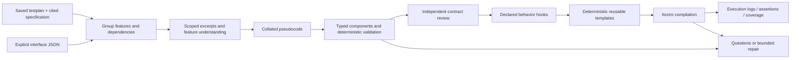

# Testplan to verification code

The functional builder lives in `src/dv_agent/codegen/`. [Feature work packages](CODE_WORK_PACKAGES.md)
now provide dependency documents and collated pseudocode before component generation.
Its reusable templates live in
`src/dv_agent/templates/codegen/`; `catalog.json` describes their inputs, dependencies,
outputs and extension slots. Design-specific names and behavior belong in a typed
implementation contract, never in protocol templates. The legacy `build-uvm` scaffold
remains available independently.



## Interactive use

Start the existing orchestrator, select a repository, then use `/plan`, `/code`, `/run`
and `/regress`. With a configured model, `/code` now designs and reviews a functional
implementation contract, renders code and attempts compilation. `/run` executes the
first functional test; `/regress` executes every generated test with its saved seed.
The model does not select the workflow's next step.

The input files remain `<run>/dv/testplan_doc.json` and
`<run>/rtl/interface_definition.json`. The selected RTL files are compilation inputs;
their contents are not supplied to the implementation model. Missing reset polarity,
timing, inactive input levels or behavior must be supplied as approved documentation
or become explicit questions. Interface names alone cannot supply these facts.

For direct use, including an operator-supplied implementation contract:

```sh
.venv/bin/python -m dv_agent.cli build-code \
  --testplan runs/example/dv/testplan_doc.json \
  --interface runs/example/rtl/interface_definition.json \
  --contract reviewed_code_plan.json --llm off \
  --rtl-file /absolute/path/to/top.sv --top peripheral \
  --out runs/example
```

Repeat `--rtl-file` for every compilation unit. Omit `--contract` and enable the model
to design the contract from saved documented evidence. `--no-compile` records `NOT_RUN`;
it does not produce compilation or simulation evidence. In the interactive terminal,
model-disabled `/code` retains the explicitly labeled legacy clock/reset smoke path.

Replay an existing functional build without model calls:

```sh
.venv/bin/python -m dv_agent.cli run-code --out runs/example
.venv/bin/python -m dv_agent.cli run-code --out runs/example --regress --timeout 180
```

The first command runs the first saved test; `--regress` runs every saved test.
`--timeout` bounds each compiler/test process in wall-clock seconds, independently
of the model API timeout. These commands load `.env`, validate saved input/source
hashes and latest-build state, then preserve per-test logs and coverage. Results
include actual scoreboard comparison counts and UVM severity counts. They return
a nonzero exit code for any failure or missing required evidence.

Set `XEZIM_BIN` to a local executable if it is not on PATH. Set `XEZIM_UVM_DIR` to an
actual UVM source release containing `uvm_pkg.sv` and `uvm_macros.svh` (either at its
root or under `src/`). Missing UVM sources produce `BLOCKED`. The adapter probes the
installed simulator's version and options before constructing commands.

To install the official UVM 2020.3.1 release locally and save its path in `.env`:

```sh
python3 tools/install_uvm.py
```

The installer downloads [Accellera's release](https://github.com/accellera-official/uvm-core/releases/tag/2020.3.1),
verifies pinned commit `78c06547a2a0a29b3dc9dcafae62b75b2ff61544`, retains its license/notice,
and installs under ignored `.deps/`. It updates only `XEZIM_UVM_DIR` in `.env` after
successful verification, preserves other settings and refuses modified existing
checkouts. Restart the orchestrator to load the setting; an existing shell variable
still takes precedence. Network/DNS access to GitHub is required. Installing the
library does not establish Xezim compatibility; real compilation remains necessary.

## Contract and generated components

`contracts.py` is the authoritative Pydantic contract (`verification_codegen_v1`).
It records exact quoted facts and JSON pointers into documented plan items; named
agents with canonical protocol roles bound to physical ports; explicit tie-offs;
simple register mirrors; typed operations and sequences; observed-event routes;
source-supported protocol checks; ordered/concurrent test stages; and extension hooks.

Implementation context is retrieved per feature. Compact documented records retain
original pointers, source IDs, semantic fields and property classifications; exact
relevant excerpts are supplied rather than the full design. All original sources remain
available locally for quote/authority validation. Dependency notes, feature pseudocode,
collated implementation pseudocode and component mappings are saved before rendering.
This replaces the former whole-plan 160k input and its compaction workaround; see
[CODE_WORK_PACKAGES.md](CODE_WORK_PACKAGES.md) for artifacts, limits and pseudocode-only use.
`code_context.json` now records per-request sizes/cache state instead of one global size.

Built-in capabilities are WISHBONE transfers/polling and serial frames with configured
word length, parity, stop bits and bit timing. Sequences support directed and masked
random payloads. Register mirrors cover simple unbanked RW/RO/WO registers with explicit
masks and optional known reset values. Unknown reset is not treated as zero. Route
qualification can follow configuration writes observed by a bus monitor, which prevents
bank-selection or divisor writes from being mistaken for payload traffic.

Each interface gets separate item-compatible configuration, driver, sequencer, monitor,
coverage subscriber and agent files. Each UVM class occupies one `.svh`; packages hold
ordered imports/includes. Common clock/reset UVCs are reused. The reset pulse sequence
now receives its explicit `reset_cfg` handle; callers must set `reset_seq.cfg`.
Virtual sequences hold typed sequencer handles and only spawn agent sequences. They
do not access virtual interfaces or implement timing behavior.

Monitors publish fresh observed transactions. Independent coverage subscribers clone
these transactions and sample operation/data/address/error/configuration coverage.
An environment subscriber samples configured cross-interface route activity. Coverage
and scoreboards are connected to monitor analysis ports, never driver request streams.
Queue-based end-to-end scoreboards compare observed input and output data and detect
unmatched transactions. Register predictions also follow observed transfers. Reset
flushes prediction state. Every executable test requires actual scoreboard comparisons.

Assertions have corresponding property and activation covers. The runner requires their
recorded activation/property hits, no assertion failures, sampled functional coverage,
the test's completion marker, a successful process exit and no UVM errors. These are
execution checks, not human acceptance or design sign-off.

Custom protocols must declare driver/monitor hooks. Additional hooks can extend
scoreboard comparisons or coverage classification. The model receives only the declared
slot context and cited facts. Deterministic checks refuse declarations, external access,
observation-side interface writes and time-consuming function hooks. These checks and
compilation are guardrails, not a complete SystemVerilog security sandbox or proof of
semantic correctness. Generated behavior always needs review.

Typed coverage goals also generate dedicated monitor subscribers with source-linked
bins/crosses and event/address filters, alongside the baseline per-agent collectors.

## Recovery, output and limits

Successful model responses checkpoint by payload/schema/prompt/model. One semantic
contract repair can use deterministic or independent-review feedback; one hook repair
can use validation feedback. After a compiler failure, one further build can repair
only declared hooks whose generated files appear in diagnostics. Missing libraries,
framework errors and DUT errors do not authorize rewriting those components or RTL.
At most two hook calls run concurrently. Shared API transport recovery still applies.

Generated projects use `<run>/code/<content-hash>/`. The fingerprint includes the
contract, interface, templates, hooks, rendered artifacts and RTL hashes. Existing edited
generated files are refused. Each build writes:

- `code_plan.json`, `contract_review.json` when model-reviewed, and `code_questions.json`;
- `traceability.json` with source fact IDs, saved plan pointers and generated paths;
- `code_manifest.json` at the run root and `tests.json` inside the code project;
- `compile.f`, `compile_result.json` and compiler diagnostics when available;
- per-test/seed execution directories with unique attempts, logs and coverage JSON.

Locks prevent overlapping writers. Publication follows complete rendering. A failed
latest generation blocks `/run` from silently using an older successful manifest.
Changed testplan/interface/generated/RTL files block execution until regeneration.
Failed compiler builds and diagnostics remain available when a hook repair produces a
new project. No stale coverage file can satisfy a new execution attempt.

The current contract does not implement arbitrary DUT state machines, banked register
mirrors, side-effect registers, interrupt prediction, FIFO occupancy prediction or error
injection. Such work remains explicit questions/extensions; generation does not claim
complete testplan coverage. One serial configuration is selected per contract. An
unvalidated RTL-derived plan remains blocked, regardless of factual-looking content.

## Acceptance evidence

`tests/test_codegen.py` checks a renamed generic peripheral, source authority/quotes,
ownership, widths, sequence races, checkpoint reuse, bounded repair, stale-input refusal,
monitor-fed coverage and honest simulator status. The optional UART acceptance fixture
uses the baseline UART specification plus an explicitly labeled integration configuration
in `tests/fixtures/codegen/uart_integration.json`. Production code has no UART names.

The UART fixture builds initialization, directed transmit/receive, status polling,
configuration reads and randomized transmit with readiness polling. It generates both
per-interface and environment coverage, register checks and qualified TX/RX scoreboards.
It is acceptance test data, not a model-generated or engineer-approved production plan.
Syntax-only tests use explicitly minimal macros; the opt-in integration test uses the
actual installed Accellera UVM 2020.3.1 release and Xezim 0.11.3, git `058f2bb`.
Real compilation and simulation now pass for the acceptance fixture's 8-bit bus,
32-clock-cycle serial bit timing and 8N1 configuration:

| Test | Seed | Scoreboard comparisons | UVM errors/fatals | Property / activation hits |
| --- | --- | --- | --- | --- |
| `basic_functional` | 1 | 3 | 0 / 0 | 30 / 30 |
| `random_transmit` | 7 | 4 | 0 / 0 | 681 / 681 |

All three coverage subscribers sampled real observed traffic. Forty-five UVM warnings
per test (principally library queue-delete warnings) and simulator warnings remain;
these runs do not establish complete UART verification or other configurations.
The initial real run caught monitor payload mismatches and missing assertion samples;
neither was accepted as a pass. Fixes declare physical wires before use, assemble serial
samples in a local variable before assigning the transaction payload, and explicitly
clock/disable each assertion and activation cover. The adapter uses Xezim's documented
`+seed` argument, not an unverified simulator-specific spelling. DUT RTL is unchanged.

Saved evidence and replay command:

```sh
.venv/bin/python -m dv_agent.cli run-code \
  --out runs/codegen-acceptance-20261030T164553714633Z --regress
```

The code project is `code/0f231192803d1ef2` under that run. Results are in its
`simulation/regress.json`, with unique per-test/seed attempt directories. To run the
real simulator regression test explicitly (no model API calls):

```sh
DV_AGENT_TEST_SIMULATION=1 .venv/bin/python -m pytest \
  tests/test_codegen.py::test_real_uart_simulation_opt_in -q
```

Live model-generated code from the latest production plan is still unvalidated;
these results apply to the explicit acceptance contract.


The current orchestrator coding flow is ordered and incremental: clock and reset binding (no model call, see
[COMMON_UVC_FLOW.md](COMMON_UVC_FLOW.md)), one interface
at a time, dedicated dependency analysis, then one feature at a time. Each unit repeats
retrieval, pseudocode, implementation, validation and checkpointing. See
[the execution and dependency plan](CODE_WORK_PACKAGES.md). `/code` and standalone
`build-code` defer compilation by default; `/run`/`/regress` compile later, or standalone
`build-code --compile` explicitly opts in. Sequence inheritance and typed `p_sequencer`
variables/settings are schema-controlled, width-checked extensions to the reusable templates.

## Waveforms and coverage

`/run wave` runs the first test and also saves `<test>.fst` beside its `simulation.log`. Open it with GTKWave or Surfer.

Every `/run` and `/regress` prints a coverage line per test and saves `coverage_report.md` beside the log: each coverage group with its samples
and percentage, and the assertions that passed. The percentages are what the testbench reported. The average is a plain mean of the plan
groups, not a weighted coverage figure. The raw simulator data is in `coverage.json` in the same folder.
