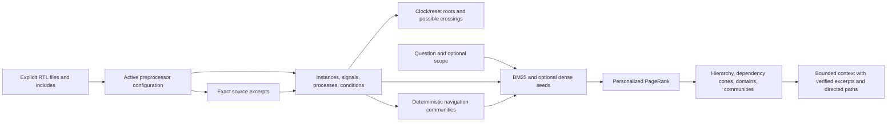

# RTL graph retrieval

`rtl_agent` builds a separate, source-backed RTL graph and fetches context for understanding hierarchy,
signal dependencies, clock/reset use and feature control. It is independently built; an explicitly
supplied graph may feed the opt-in [test-plan RTL observations](RTL_OBSERVATIONS.md) stage (D-032).
The compact interface JSON and UVM generation are unchanged.



## Build and inspect

From the `dv_agent/` repository root:

```bash
.venv/bin/python -m rtl_agent build-graph \
  ../baseline_repos/uart16550/rtl/verilog/*.v \
  --top uart_top --out runs/uart_rtl_graph

.venv/bin/python -m rtl_agent graph-info --graph runs/uart_rtl_graph/rtl_graph.json

.venv/bin/python -m rtl_agent context \
  "uart_top.regs.receiver.rstate clock reset" \
  --graph runs/uart_rtl_graph/rtl_graph.json \
  --scope uart_top.regs.receiver --save runs/uart_rtl_graph/receiver_context.json
```

`query` and `context` return the same evidence bundle. Build accepts `-I` include paths, `-D` defines
and integer `-P NAME=VALUE` top-parameter overrides. Inputs are explicit files in compilation order;
select the intended source set instead of including backups or alternate module definitions.

The graph includes:

| Layer | Contents |
|---|---|
| L1 | Exact original file/line/character spans, text and SHA-256 hashes |
| L2 | Module definitions, instance-qualified ports/internal signals, parameters, processes and control conditions |
| L3 | Seeded deterministic graph communities; source-derived navigation labels, not behavioral claims |

Relations cover containment, module instantiation, named/positional/wildcard port connections,
parameter settings, process reads/writes, whole-signal data/control dependencies, exact aliases,
event sensitivity, clock use and reset candidates. Each non-navigation relation carries source evidence.
Identical module types instantiated twice have separate signals and domains.

Wire initializers are continuous assignments; variable initializers are initialization processes.
Assignments to `mem[index]` write the aggregate `mem` and read `index`. Arithmetic and conditions
are retained as expressions; this is not bit-precise symbolic execution.
Parameter values are resolved only within the supported integer subset. Typed bit-vector parameters
and arithmetic needing sized constant semantics remain symbolic, with explicit diagnostics.

## Clock, reset and feature interpretation

Clock candidates come from edge-triggered sensitivity expressions. A reset candidate requires a
leading single-signal conditional branch assigning constants. Its condition determines polarity;
membership in the event list distinguishes asynchronous from synchronous candidates. These roles
are **INFERRED**, with the raw source attached. Names alone never establish clock/reset roles.
Ambiguous multiple events or disagreeing polarity produce explicit diagnostics.

Clock/reset roots propagate through exact single-signal aliases and port bindings. Computed, gated,
sliced or inverted expressions remain dependencies; they are not silently treated as identical clocks
or resets. Different clock roots connected through a dependency cone produce possible crossings
marked `NEEDS_REVIEW`; this is not CDC verification or proof of a bug.

Source `if`/`case`/loop selectors become searchable control-condition nodes. Optional `--features`
accepts explicit functional labels:

```json
{
  "Receive path": {
    "description": "User-supplied navigation label",
    "targets": ["uart_top.regs.receiver", "uart_top.regs.receiver.rstate"]
  }
}
```

Targets must match exact instance or signal paths. Feature labels/grouping are inferred navigation;
they do not establish intended behavior or convert implementation into specification authority.

## Combined fetching

1. BM25 searches names, expressions, source excerpts and typed relationships. Optional embedding
   cosine scores fuse with lexical scores; exact instance/signal matches anchor the query.
2. Personalized PageRank propagates through a typed, weighted semantic view. Source excerpts remain
   citations rather than connectivity bridges between instances sharing the same source file.
3. Bounded fetching combines entity/hierarchy neighbors, directed upstream and downstream dependency
   cones, clock/reset context, and community navigation. A clock/reset pair and a minimum share from
   each available context source are reserved before rank fills the remaining slots.
4. Paths retain actual relation direction even though PageRank navigation is undirected. Hop bounds
   apply during traversal, not after an unconstrained weighted shortest-path search.
5. Facts are emitted only when an associated exact, hash-verified excerpt fits the evidence budget.
   Missing/truncated evidence is explicit; candidate nodes distinguish `VERIFIED` from `NOT_INCLUDED`
   citations. The bundle is ready for a downstream model, without making model-written behavior claims.

Scope restricts entities to an exact instance and its descendants, with their module/feature navigation.
Community summaries are reduced to in-scope members. Canonical clock/reset root IDs may name ancestor
ports because these identify the connected net beyond the selected instance.

Defaults: 16 context nodes, 3 hops, 256 unique context expansions, 48 facts, 16 excerpts and 24,000
excerpt characters. Configure `--top-k`, `--hops`, `--max-expansions`; the Python `QueryConfig`
also exposes evidence budgets and retrieval weights. Ranking itself operates on the bounded saved graph.

## Optional dense embeddings

No model endpoint is hardcoded and no API is called by default. Python callers can supply an explicit
`rtl_agent.dense.Embedder` (`model`, `embed(texts)`) to `build_index`; calls are batched and bounded.
Alternatively import precomputed embeddings:

```bash
.venv/bin/python -m rtl_agent index-graph --graph runs/uart_rtl_graph/rtl_graph.json \
  --embeddings node_vectors.json --out runs/uart_rtl_graph

.venv/bin/python -m rtl_agent query "receiver state reset" \
  --graph runs/uart_rtl_graph/rtl_graph.json \
  --dense-index runs/uart_rtl_graph/rtl_dense_index.json --query-vector question_vector.json
```

Embedding input is `{"model":"your-model","vectors":{"<node ID>":[0.1,0.2]}}`; query input is
`{"model":"your-model","vector":[0.1,0.2]}`. Graph fingerprints, model identity, node IDs, dimensions,
finite values and nonzero vectors are checked. Any graph/source/configuration change invalidates the
index. Vectors remain in a local JSON/NumPy index; there is no vector database. Provider integration
and live embedding quality are unverified; no retrieval-improvement claim is made without an evaluation.

## Limits and evidence boundaries

This bounded frontend does not elaborate arbitrary SystemVerilog. Generate blocks, task/function
bodies and unsupported module items become explicit gaps. Procedural loops are modeled symbolically,
not unrolled. Bodies with unresolved local declarations/shadowing are omitted. Missing modules remain
unresolved instance nodes. Unsupported port syntax or malformed structure fails clearly. Partial
analysis is reported as `PARTIAL`, not complete design understanding.

Build defaults: 256 instances, depth 16, 20,000 nodes, 100,000 edges; existing preprocessing limits
also apply. No original RTL is modified. Graph data is a source snapshot; rebuild it after source
changes. An excerpt's path/hash/offset identifies its build-time source, not the current disk revision.

The graph uses NetworkX and optional NumPy, already present in this project. It imports no `dv_agent`
code. Interface commands retain their lightweight path; graph commands are registered only in the
standalone `rtl_agent` CLI. Compilation, simulation, actual reset effectiveness, protocol correctness,
and CDC safety are not established by this static graph.
